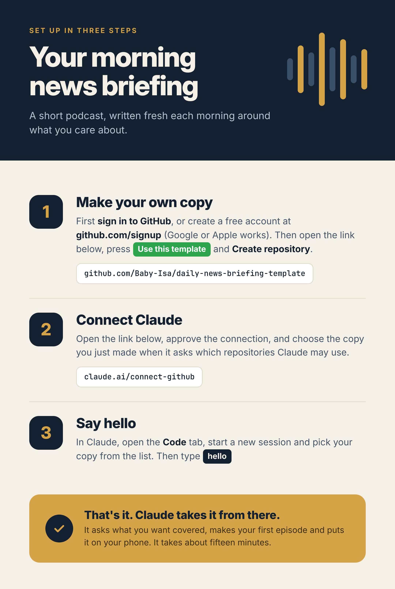

# Your morning news briefing

A short podcast, written fresh every morning around what you care about,
and delivered to the podcast app on your phone. Claude sets it up with you
in about fifteen minutes and then runs it for you.

## What you need

- A Claude subscription that includes Claude Code (the "Code" tab).
- A free GitHub account. You can sign up with Google or Apple in a minute.

## Set it up in three steps

**1. Make your own copy.** Sign in to GitHub first (the button below only
appears once you are signed in; you can create a free account at
github.com/signup). Then press the green **Use this template** button at
the top of this page, and **Create a new repository**. Give it any name
(for example `my-briefing`) and press **Create repository**.

**2. Connect Claude.** Open [claude.ai/connect-github](https://claude.ai/connect-github),
approve the connection, and when asked which repositories Claude may use,
choose the one you just created.

**3. Say hello.** In Claude, open the **Code** tab, start a new session,
pick your new repository from the list, and type **hello**. Claude takes it
from there: it asks what you want covered, makes a first episode, and puts
it on your phone.

## Afterwards

Keep that Claude chat. It is the one that writes your briefing each
morning, and it is where you change anything: "less politics", "add this
source", "make it five minutes", "follow this company". Just say it.

## Good to know

- Your copy is public by default, like this page. It holds your topic
  preferences and the text of recent briefings, at an address nobody will
  find unless you share it. You can make it private; Claude will explain
  how if you ask.
- Writing each episode uses part of your Claude allowance. If you run out
  for the week, the briefing pauses until it resets.
- There is nothing to install and nothing else to pay for.
